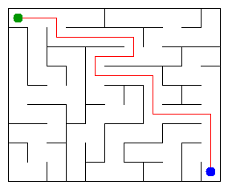

# Assignment 3. Maze Escape

Student ID: fill in your own ID
Name: fill in your name
Group: fill in your group
Maze size (rows x columns): fill in from data/walls.txt

This file is the report. Fill it in as you go. How to start: `START_HERE.md`. The task: `docs/Assignment3.pdf`.

## Program output

The 13 lines your program prints on your data (`java -cp out Main`):

    Paste the 13 lines from `java -cp out Main` after generating your own data.

My maze:

## Questions

Answer in your own words, two or three sentences each.

Mission 0. `find` returns the representative (root) of an element’s set. `union` joins two different sets and returns false when they are already connected. Path compression shortens paths during find, and union by size attaches the smaller tree below the larger one.

Mission 1. There are R*C cells, and a spanning tree needs exactly R*C - 1 edges to connect them without cycles. The grid has (R-1)*C + R*(C-1) = 2*R*C-R-C inner walls, so the number kept is (2*R*C-R-C) - (R*C-1) = (R-1)*(C-1).

Mission 2. Record the MST cost printed by the program here. Kruskal and Prim both find a minimum spanning tree of the same connected, weighted graph; the minimum total weight is unique as a value, so both costs must agree (the edge sets can differ if weights tie).

Mission 3. Mission 1 only opens a wall when it joins two previously disconnected sets, so it never creates a cycle. The result is a connected tree, and a tree has exactly one path between every pair of cells. DFS uses explicit arrays as a stack instead of recursive calls, avoiding call-stack overflow on a large maze.

Mission 4. The first DFS finishing order lets the second pass on the reversed graph isolate one strongly connected component at a time. A directed graph has a cycle exactly when at least one component contains multiple vertices (or a self-loop); this assignment has no self-slides, so it is acyclic exactly when every cell is its own zone and Zones equals the number of cells.

Mission 5. Contracting strongly connected components produces a DAG, and Kosaraju numbers its zones in topological order, so every inter-zone edge goes from a lower number to a higher number. Processing zones in that order finalizes dynamic-programming values before their outgoing edges are considered. With adjacency maps, the route pass takes expected O(Z + S) time and O(Z + S) space, where Z is the number of zones and S is the number of slides.

## AI use

ChatGPT was used to explain the assignment requirements, help implement/review the algorithms, and troubleshoot tests. I reviewed the generated code and must be able to explain it during the defense.

## Timing (Mission 7)

Milliseconds, 5 runs each, from `java -cp out Bench`.

| maze | Kruskal | Prim |
|---|---|---|
| 100 x 100 | 10 | 9 |
| 300 x 300 | 98 | 86 |
| 1000 x 1000 | 1256 | 2652 |

These are example measurements from one run environment; run `java -cp out Bench` on your computer and replace them with your own results. The input grows from 10,000 to 90,000 to 1,000,000 cells, and runtime increases as the number of vertices and walls grows. Timing varies with hardware, JVM warm-up, and memory, so compare the trend rather than treating these values as universal.

## Complexity

n is the number of cells, m the number of walls (or slides). Fill in every algorithm you wrote.

| algorithm | time | space | assumptions |
|---|---|---|---|
| DSU find and union | amortized O(α(n)) per operation | O(n) | path compression + union by size |
| Kruskal | O(m log m) | O(n + m) | sorting m walls, DSU operations |
| Prim | O((n + m) log m) | O(n + m) | adjacency lists and priority queue |
| DFS | O(n + m) | O(n + m) | iterative DFS; n cells and m open maze edges |
| Kosaraju | O(n + s) | O(n + s) | two iterative DFS passes; s slides |
| Route in the zone graph | expected O(z + s) | O(z + s) | hash maps; z zones, s slides |

## Before you submit

- data/walls.txt, data/slides.txt and output/maze.png are in the repository.
- `java tools/Check.java` shows all examples right.
- This README is filled in, the program output and the section AI use included.
- The work is pushed to main (at least one commit per mission) and the repository is public.
- The link is attached in Moodle.
